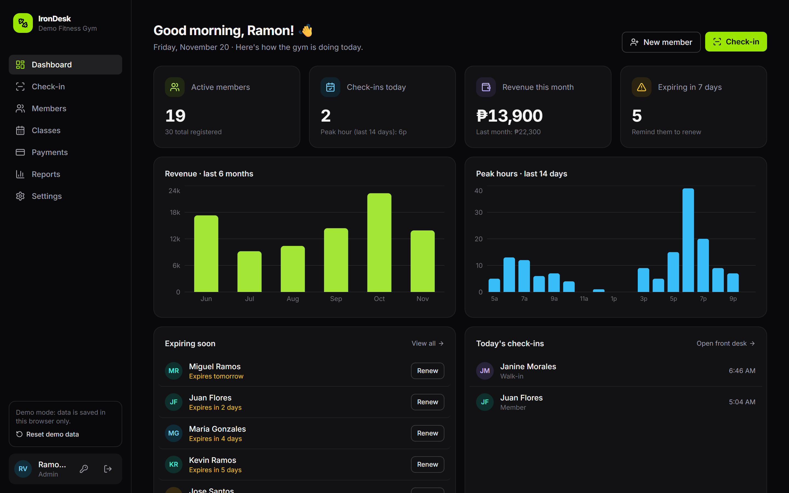
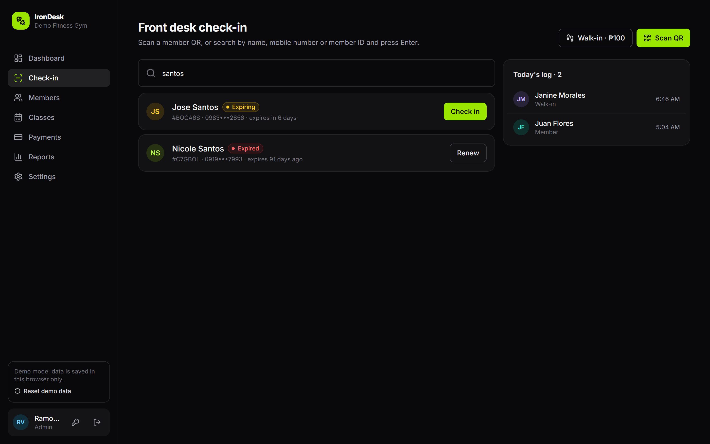
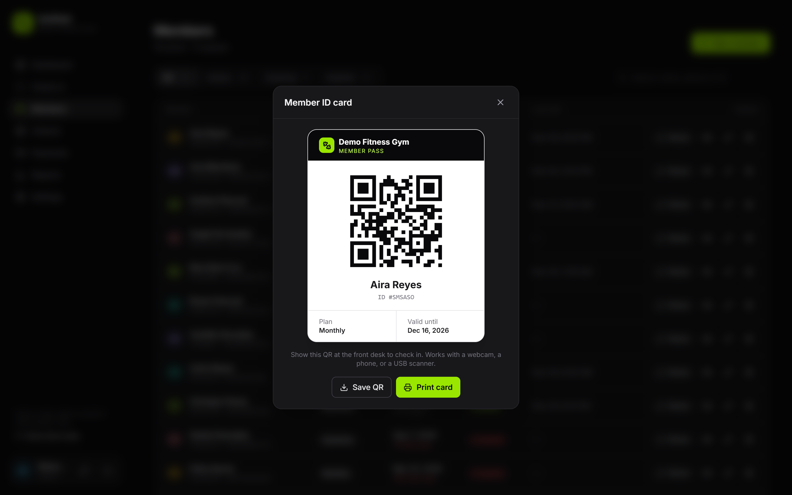
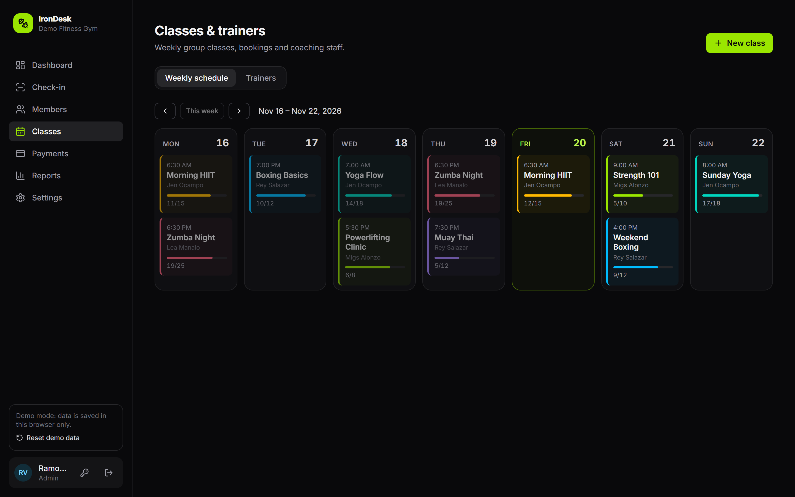
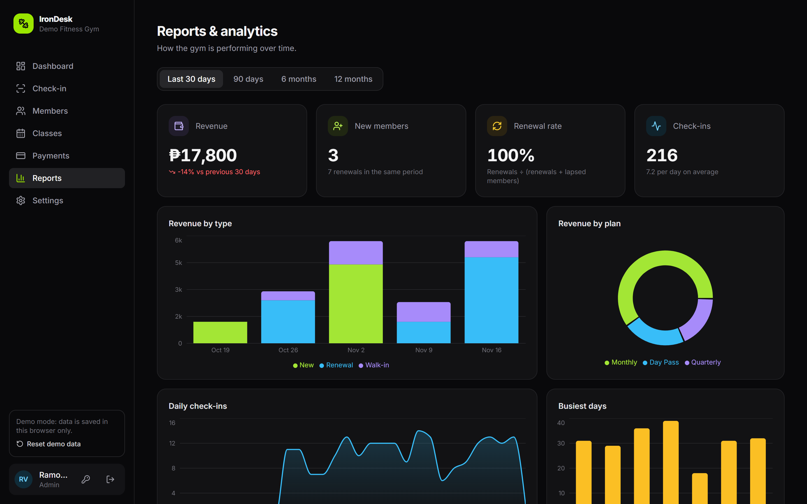
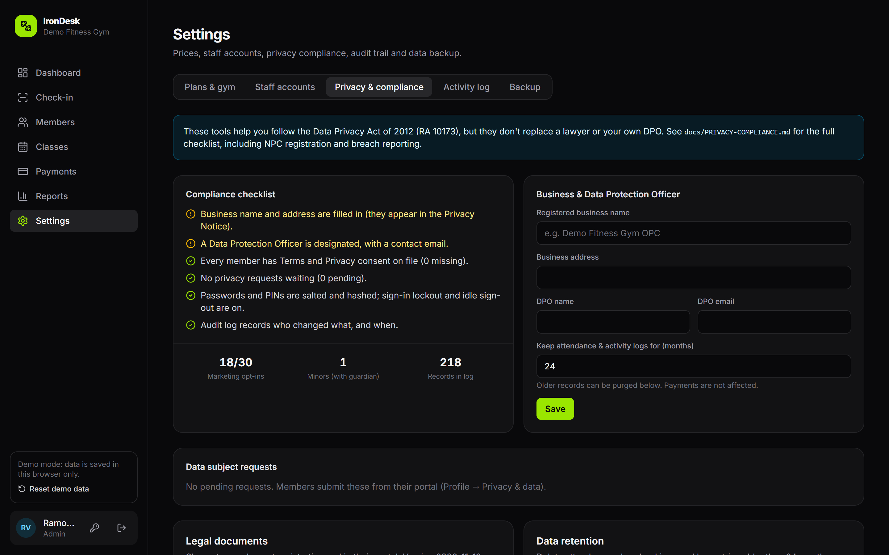
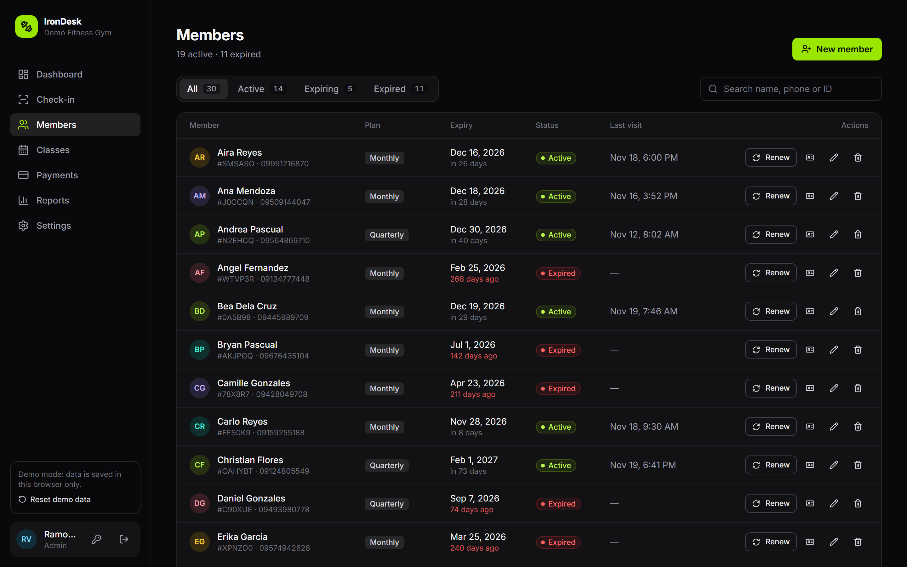
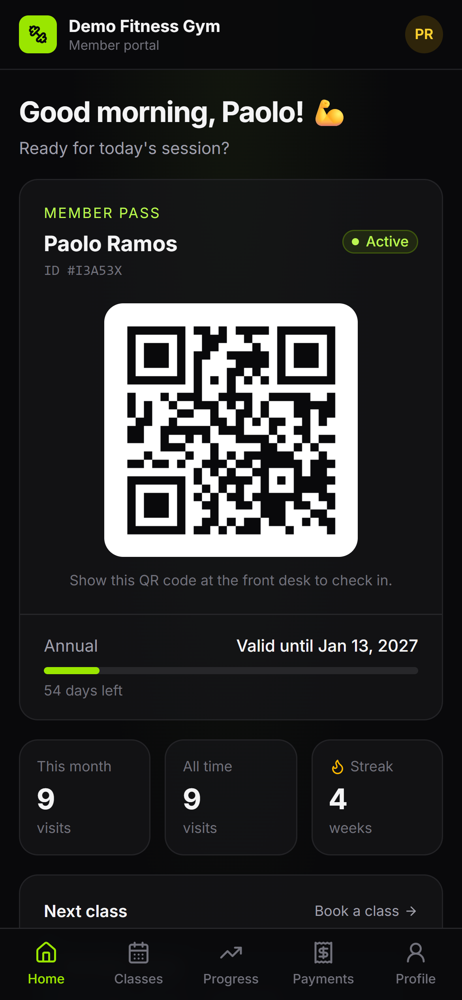
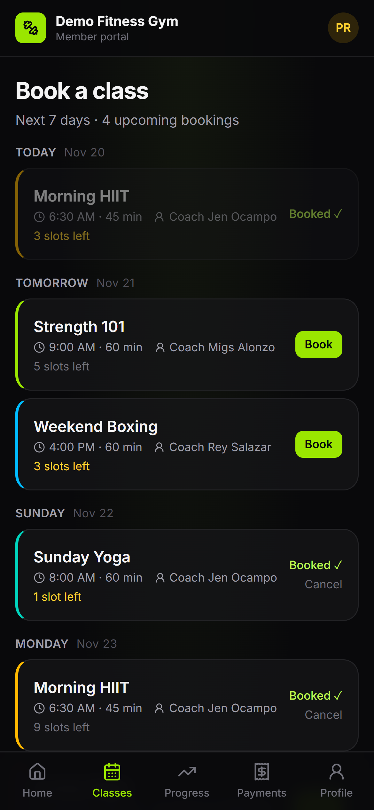

# IronDesk: Gym Management System

A gym management system for **admins**, **front-desk staff** and **members**: QR check-in, memberships and renewals, group classes, payments, analytics, a mobile-first member portal, and Data Privacy Act (RA 10173) compliance tools. It runs on a **Supabase** backend with Row Level Security on every table.

**🔗 Live app:** [irondesk-nine.vercel.app](https://irondesk-nine.vercel.app). It's a real deployment, so sign-in needs an account created by the gym. To explore every screen with fictional data, [run the demo locally](#run-it) (no setup or account needed).




## Screenshots

| Front-desk check-in | Members & QR ID card |
|---|---|
|  |  |
| **Weekly class schedule** | **Reports & analytics** |
|  |  |
| **Privacy & compliance** | **Member list** |
|  |  |

<table>
  <tr>
    <th>Member portal: digital pass</th>
    <th>Member portal: book a class</th>
  </tr>
  <tr>
    <td></td>
    <td></td>
  </tr>
</table>

<sub>All names and numbers in the screenshots are fictional demo data.</sub>

## Highlights

- **Three roles, one app.** A staff console for the front desk and admins, and a phone-sized portal for members.
- **The database is the security boundary.** Postgres Row Level Security on every table, business rules (capacity, expiry, consents, erasure) in `SECURITY DEFINER` functions, and an append-only audit log written by triggers. Editing the JavaScript in a browser gets nobody anything.
- **70 automated security tests** (`npm run test:db`) run the real migration on Postgres (PGlite, in-process, no Docker) and check what every role can and cannot read or change.
- **Passwordless member sign-in** with a code sent by email, **MFA (TOTP) for admins**, and forced change of temporary staff passwords.
- **Realtime sync.** A check-in at the front desk appears on every open screen instantly.
- **Built for the Philippines.** ₱ pricing, GCash, Asia/Manila time for all "today" rules, Data Privacy Act consent records, and BIR-aware payment slips.

## Features

### Front desk
- **QR check-in** with a webcam, a phone camera, or a USB/Bluetooth scanner, or search by name, phone or member ID
- Entry rules: expired members are blocked, a second check-in on the same day is flagged, and members expiring soon get a reminder
- Walk-in day passes in one step, and a printable member ID card with a QR code

### Members & memberships
- Register with **health screening**, **separate recorded consents** (terms, privacy, health data, marketing) and **guardian consent for minors**
- Renewals stack on the current expiry; expired members restart from today
- Profiles with payments, visits, weigh-ins (weight and BMI chart) and class history

### Classes & trainers
- Weekly calendar with capacity bars, type-ahead booking, and duplicate and capacity checks enforced in the database
- Trainer profiles with their weekly classes and 30-day attendance

### Payments & reports
- Monthly Cash / GCash / Card breakdown, CSV export (safe from formula injection), and printable payment acknowledgements
- Revenue trends, revenue by plan, renewal rate, daily check-ins, busiest days, top members, and class fill rate

### Member portal (mobile-first)
- Digital pass with a QR code, days left, visits and a weekly streak
- Book or cancel classes, log weigh-ins, view payments and receipts
- **Privacy self-service:** download your data, withdraw marketing consent, request correction or erasure

### Admin
- Plans, prices, staff accounts (created by an Edge Function that holds the service-role key) and the activity log
- **Privacy & compliance:** a checklist, a data-subject request queue (approving an erasure de-identifies the member everywhere, including the audit log), and a retention purge

### Roles

| | Admin | Staff | Member |
|---|:-:|:-:|:-:|
| Check-in, walk-ins, register and renew members, payments | ✅ | ✅ | — |
| Book classes, log weigh-ins | ✅ | ✅ | ✅ own only |
| Read health screening answers | ✅ | flag only | ✅ own only |
| Plans, classes, trainers, settings, staff accounts | ✅ | — | — |
| Reports, activity log, privacy requests, erase members | ✅ | — | — |

## Tech stack

| Layer | Tools |
|---|---|
| Front end | React 18, TypeScript (strict), Vite, Tailwind CSS v4, React Router 7, Recharts, lucide-react, `qrcode` + `jsQR` |
| Backend | Supabase: Postgres with RLS, Auth (email OTP, password, TOTP MFA), Realtime, Edge Functions (Deno) |
| Testing | PGlite (Postgres compiled to WASM) with a stubbed Supabase `auth` schema: 70 policy and business-rule tests |
| Hosting | Vercel, with a strict Content Security Policy and security headers |

## Run it

```bash
npm install
npm run dev        # http://localhost:5173
```

**Without a `.env.local` file the app runs in demo mode:** fictional data stored in your browser, with one-click demo accounts:

| Role | Sign in with |
|---|---|
| Admin | `admin` / `admin123` |
| Front desk | `staff` / `staff123` |
| Member | any member's mobile number + PIN `246810` |

**To run on Supabase**, copy `.env.example` to `.env.local`, add your project URL and publishable key, and follow [docs/SUPABASE-SETUP.md](docs/SUPABASE-SETUP.md) (migration, auth settings, first admin, Edge Function).

```bash
npm run test:db    # 70 database security tests (no Docker needed)
npm run build      # type-check + production build
```

## Project structure

```
src/
  pages/          Staff console: Dashboard, CheckIn, Members, Classes, Payments, Reports, Settings, logins
  member/         Member portal: Home, Classes, Progress, Payments, Profile
  components/     Layout, UI kit, modals, QR card + scanner, MFA setup, security screens
  lib/            Demo store, utils, security.ts (hashing, lockout, policies), legal.ts (versioned legal templates)
  lib/cloud/      Supabase client, cloud store provider, mappers, email-code + MFA auth
supabase/
  migrations/     Schema, RLS policies, business-rule functions, audit triggers
  functions/      admin-users Edge Function (staff accounts)
  tests/          PGlite security tests
  seed.sql        Starter plans, trainers and classes
docs/             Supabase setup, privacy compliance, incident response, staff guidelines
```

## Security & compliance

- [SECURITY.md](SECURITY.md): the controls, the threat model, and what demo mode does not protect
- [docs/PRIVACY-COMPLIANCE.md](docs/PRIVACY-COMPLIANCE.md): Data Privacy Act, BIR, Consumer Act and waiver guidance, plus a go-live checklist
- [docs/INCIDENT-RESPONSE.md](docs/INCIDENT-RESPONSE.md): breach response, including the 72-hour NPC notification
- [docs/STAFF-GUIDELINES.md](docs/STAFF-GUIDELINES.md): front-desk rules

> The Privacy Notice, Membership Terms and Waiver are templates, **not legal advice**. Have a Philippine lawyer review them before a real gym uses them. Payment slips are acknowledgements, not BIR invoices.

## Roadmap

- SMS / email reminders before a membership expires
- Online payments (GCash / Maya) and self-service renewals
- Paginated queries for gyms with thousands of members

## License

[MIT](LICENSE) © 2026 Joshua Buiza
